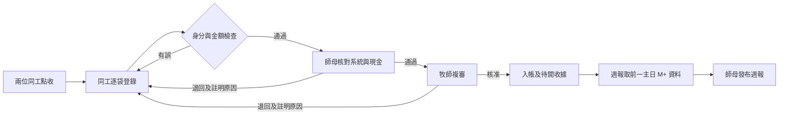
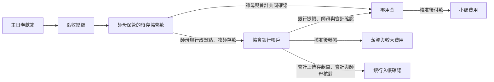

# 協會會計、奉獻與徵信模組：已確認需求與實作規格

更新：2026-10-21。狀態：需求定稿、待逐段實作與驗收。適用：教會 OS 的 M+ 操作入口；法定收款與收據開立主體為協會。本文記錄與使用者逐題確認的決定，若實際協會登記名稱、統編、地址或收據格式與現有資料不同，應從協會主檔讀取，不寫死在程式。

## 1. 核心規則

1. M+ 是專案／事工歸屬，協會是唯一對外收款與收據開立主體。所有協會專案自 2027 年使用同一組按年度、收據類型分開的協會收據流水號。
2. 每筆收入保留「來源管道」與「指定專案」。來源可為主日現金、教會網站藍新／LINE Pay、協會網站藍新／LINE Pay、其他人工匯入。週報納入條件是**指定給 M+ 且已核准入帳**，與來源網站無關。
3. M+ 週報不得顯示姓名、身分證、電話、地址、收據抬頭或其他專案捐款；它只讀取獨立產出的公開快照。週報公布後更正要形成新版本，重新核准再由師母發布。
4. 2026 年及之前的收據沿用舊流程；包括 2027 年才開立的 2026 年年度收據。新系統僅對 2027 年起的奉獻核發新編號。歷史匯入不可重開舊收據。
5. 2026 年逐袋 Excel 與舊奉獻編號 Excel，待系統完整建置後才請使用者上傳。開發與驗收使用合成資料；匯入工具應有欄位對應、預覽、錯誤報告與可回滾批次。

## 2. 角色、權限與流程

| 階段 | 登錄／執行 | 核對／核准 | 退回時 |
| --- | --- | --- | --- |
| 主日奉獻 | 兩位同工點收；同工逐袋登錄 | 師母對現金及系統；牧師複審入帳 | 退回同工修正，留存前後版本，重走師母、牧師 |
| 現金轉零用金 | 師母及會計同工共同記錄，於師母核對後可先執行 | 兩人共同確認金額與用途 | 以沖正分錄修正，不刪原紀錄 |
| 存入協會銀行 | 師母與行政同工共同盤點；牧師存款；會計上傳存款單 | 會計與師母共同核對銀行入帳 | 差額列待查，不修改原奉獻收入 |
| 一般費用 | 同工提報、會計核對憑證、師母審閱、牧師核准 | 行政或會計依個案付款 | 退回提報人；留下原因與版本 |
| 薪資 | 師母建立個別薪資、牧師核准並轉帳 | 會計僅見總額及銀行對帳結果 | 個別薪資僅師母／牧師可讀寫 |
| 週報 | 系統取前一主日已核准 M+ 奉獻產生預覽 | 師母按發布 | 未經牧師核准則延後發布，不顯示暫定金額 |

權限要由後端逐項驗證，不能只靠前端隱藏按鈕。功能權限至少分為奉獻登錄、現金核對、牧師核准、收據、費用、薪資個人資料、徵信發布與匯出。會友資料權限不自動授予身分證讀取權。每項核准及敏感資料檢視都要留下操作者與時間。

### 人流：主日奉獻審核

### 金流：現金與協會帳戶

兩圖中的 `C → D` 與 `C → E` 是資金位置轉移，不能新增奉獻收入；退回奉獻系統資料也不能刪除已發生的現金轉移。

## 3. 會友與捐款人主檔

- 既有 `public.members` 是 M+ 會友主檔；奉獻編號建議置於一對一的 `finance.member_offering_profiles`，避免改動一般會員清單的查詢及直接暴露個資。編號為手動指定且唯一的四位數文字，例：`13` 匯入後為 `0013`；不得重複、不得重新指派、不得給家庭共用。此編號只適用 M+，不能當協會跨專案捐款人 ID。
- 快速建檔：姓名、四位奉獻編號、至少一種聯絡方式（手機／電話／Email）；地址欄位可留白。身分證可留空並標示待補。會員搜尋依姓名或編號，選定後明確顯示姓名與編號。
- 未建檔仍可用姓名暫存奉獻，但每次都提醒建檔；第二次同名仍提醒，不能自動合併。袋上姓名與編號指向不同人時阻止送審，保留草稿供人工釐清。
- 袋上的電話、地址、身分證與主檔不同時先顯示差異；同工確認後才能更新主檔，保留原值與更新人。完整身分證只在授權的安全處理路徑中加密儲存，日常頁僅顯示有無與遮蔽末碼；不把完整證號存入袋或週報紀錄。
- 每筆奉獻分開記錄「袋上／提交人」、「實際捐款人」、「收據受領人」。若只是代投，收據受領人可為已確認的實際捐款人；若奉獻者要求不同姓名而捐贈事實未確認，收據及稅務上傳保持待確認。收據姓名與其證號必須屬同一人。
- 稅務上傳須有明確同意，可記錄網站選擇或已收紙本同意書、同意版本、時間與證據。沒有證號或同意就排除匯出並列待補，不阻止奉獻入帳。權限不足者只看「已補／待補」。

## 4. 奉獻登錄表單

### 批次表頭

| 欄位 | 必填 | 用途與限制 |
| --- | --- | --- |
| 奉獻日期、聚會／來源管道、指定專案 | 是 | 主日批次預設 M+、現金；網站支付必存第三方事件 ID |
| 兩名點收同工、點收時間 | 主日現金是 | 兩人不得為同一帳號 |
| 現金實點總額、袋數、匿名現金總額 | 主日現金是 | 系統即時計算登錄合計與差額 |
| 批次狀態、版本、修正原因 | 系統 | `draft → spouse_review → pastor_review → booked`；退回至 `returned` |

### 每位奉獻者主列與可展開袋明細

主列：會友搜尋／固定奉獻編號、袋上姓名、是否臨時姓名、聯絡資料差異提醒、週報露出設定、收據偏好（單次／年度／不開）、電子或紙本、稅務同意狀態。六個金額欄：`十一奉獻`、`感恩奉獻`、`宣教奉獻`、`建堂奉獻`、`慈惠奉獻`、`指定奉獻`。另設 `一般／不具名奉獻` 僅用於匿名零錢的彙總行。

一人同日可有多袋；展開每袋時保留系統產生的批次內序號、袋面資訊、各類金額、指定用途（先選預設專案，無對應時可填文字）、袋合計及照片／紙本參照。袋合計必等於各分類加總；批次合計必等於所有袋與匿名款合計；師母實點現金和批次合計不符時不得送牧師核准。每筆金額皆用整數新台幣儲存，不用浮點數。

網站奉獻不建立現金袋，記支付訂單、交易、回呼驗證、退款／撤銷、對帳資料；回呼重送必須幂等。同一支付事件不可重複入帳，支付成功且銀行／金流確認後才進入可核准狀態。教會或協會網站若指定 M+，兩者都進 M+ 週報。

## 5. 公開週報與徵信

公開列的判定順序：隱藏設定優先；已建檔會友顯示四位奉獻編號；未建檔且允許公開者以中間 `○` 遮蔽姓名；匿名捐款且允許公開者顯示「匿名」；選擇不列者只計入分類總額。特別需求可設長期或單筆不露出。主日現金、教會網站與協會網站指定 M+ 的奉獻均依此規則處理。每列列出分類與金額；指定奉獻列出用途與金額。週報只讀公開快照，不直接查含證號或收據資料的交易表。

同一已確認會員跨袋及跨管道應依會員 ID 彙為一列；未建檔者即使遮蔽後姓名相同也不得自動合併。指定用途若為自由文字，發布前須人工檢查其中是否含姓名、電話等個資。

每週應保存：所屬主日、來源已核准批次及版本、分類總額、公開列、隱藏金額、產生時間、師母發布時間與版本。紙本 PDF 和網站週報讀同一份已發布快照，且保留長期存檔。公開頁可設定 `noindex`，但不可把它當作隱私保護手段。

## 6. 收據、稅務與捐物

- 所有收據由協會開立。2027 年起協會所有專案共用序號；現金與捐物序號分開、各年度重設。序號應在核發交易內一次取得，取消／作廢留痕且不回收舊號。不要把來源系統原收據號當作新號。
- 已入帳奉獻進入 `待開收據`；行政／會計同工核對後按核發。單次收據合併同一主日、同一會員及同一實際受領人的多袋／分類；年度收據於年結後彙總。無收據偏好不核發。電子收據寄至會員已登記 Email；無 Email 時改紙本。寄送失敗狀態為待重寄，重用原號。
- 捐物：捐贈日期、實際捐款人、物品名稱／規格、件數、單位、狀態、照片、估價來源與依據、核定價值、接收人、審核人、專案及收據偏好。未有可靠估價依據時不可自動產生可抵稅金額。與金錢收據分序列。
- 稅務匯出只選實際受領人姓名與其證號一致、證號已補、明確同意、未作廢且屬申報年度的收據；匯出先預覽排除原因，完成後記錄檔案雜湊、操作者與時間。實際格式須對照當年度官方規格。

## 7. 現金與費用帳

主日現金以總點收額入收入帳；現金流轉另記 `待存協會款 → 零用金` 或 `待存協會款 → 協會銀行`，不可把轉入零用金再認一次收入。應同時能查「待存現金」、「零用金」、「協會銀行已確認款」與未核對差額。師母持有待存款與零用金兩個餘額；每次補零用金時盤點，補充來源可為協會銀行提領或主日現金。每個轉移紀錄有雙方確認與憑據。

一般費用分類：人事、租金、行政、雜支、油資、電信、修繕、膳食、其他。每張憑證只選一類；無憑證可填原因並經牧師核准。費用可為預支或事後核銷，付款可用零用金或協會銀行，不設固定大額門檻。個別薪資在受限資料區，會計只看彙總、銀行對帳結論；一般費用流程不授予個別薪資讀取權。

## 8. 建議資料結構與不可破壞約束

新模組使用獨立 `finance` 私有 schema，從受權伺服器 API 操作；只提供必要的遮蔽會員搜尋及公開週報快照，避免將內部表直接開放 Data API。最少表：

| 表／實體 | 關鍵欄位與約束 |
| --- | --- |
| `projects` | 協會專案 ID、代碼、名稱、是否供 M+ 週報、是否供協會網站徵信 |
| `member_offering_profiles` | 會員 ID、四位奉獻編號唯一、建立／停用時間；歷史號不重用 |
| `donors`／`donor_private` | 受領人身分、聯絡方式；證號加密與遮蔽欄分表，授權獨立 |
| `offering_batches` | 日期、來源、狀態、版本、實點／登錄總額、兩名點收人、師母與牧師審核紀錄 |
| `offering_bags`／`donation_lines` | 批次內袋序號、袋上姓名、會員、受領人、分類、指定用途、整數金額、公開設定；同袋分類可多筆 |
| `payment_events` | 提供者、merchant、交易 ID、事件 ID 唯一、簽章驗證及對帳狀態；原始敏感 payload 限期保留 |
| `cash_movements` | 來源／目的帳、金額、雙人確認、憑據、原始批次；沖正採新紀錄 |
| `receipts`／`receipt_sequences` | 協會、年度、類型、全協會流水號唯一、狀態、原交易關聯、寄送狀態 |
| `in_kind_items` | 品名、件數、照片、估價依據與核准價值，關聯捐物收據 |
| `expenses`／`payroll_private` | 費用流程、付款方式、憑證；個別薪資獨立加權限 |
| `bulletin_snapshots` | 週別、來源版本、分類總額、公開列、發布人、發布版本；公開 API 只讀已發布版本 |
| `audit_events`／`imports` | 不可覆寫的操作記錄、欄位前後值摘要、原始匯入來源與錯誤報告 |

交易儲存需守住：狀態轉移由後端原子處理、每步驗證操作者角色；重要寫入有幂等鍵及樂觀版本；已入帳原紀錄不可刪除，只能作沖正／更正並重審；外部支付只能按已驗證事件入帳；所有金額為正整數，退款另記；同一袋分類明細加總等於袋合計，全部袋合計等於批次登錄總額。禁止週報公開資料攜帶任何證號、聯絡資訊或完整姓名。

## 9. 2025 思遠檔的欄位處理

來源：`orders_2026-10-21.csv`，原始表頭 37 欄，其中 `姓名`、`E-mail`、`聯絡電話` 重複，匯入時要依位置重新命名。2025 資料只做歷史對帳、欄位映射及來源追溯，不直接產生 2027 新收據。原檔保存在受限匯入區，日常 UI 只存整理後資料。

| 處理 | 原始欄位 | 理由 |
| --- | --- | --- |
| 保留為交易核心 | 捐款序號、捐款編號、專案名稱、項目編號、捐款/義賣、項目名稱(捐款)、數量、金額、(數量x金額)、捐款合計、下單時間、捐款狀態、捐款來源、指定奉獻 | 對帳、專案歸屬、品項及金額驗證；同一訂單多列須防重複計總 |
| 保留為收據／稅務受限資料 | 收據需求、同意捐款紀錄上傳國稅局(公司行號等法人不適用)、收據抬頭、收據身分證字號/收據統一編號、收據編號、年度收據編號、地址 | 查核舊收據與同意來源；證號及地址限權限並加密，空白號仍保留來源狀態 |
| 保留為聯繫／公開選擇資料 | 姓名（兩欄需查來源定義）、聯絡電話（兩欄）、手機、E-mail（兩欄）、芳名錄、會員編號 | 捐款者連結、通知與公開意願；欄位相同不表示值一定相同，不自動合併 |
| 僅原檔保存，日常欄位不保留 | 規格、定期定額編號、定期定額捐款開始／結束／年月、捐款者留言(定期定額)、管理員備註(定期定額) | 本階段不靠思遠持續收款；若未來啟用定期定額，再定義自己的授權與訂閱模型。留言／備註避免混入會計欄位 |

## 10. 實作順序與完成定義

1. 建立私有資料表、欄位檢查、權限與遮蔽讀取；先以合成資料驗證帳號隔離及身分證不可外洩。
2. 建會員奉獻編號、暫存姓名與袋登錄；完成現金點收、師母核對、牧師複審及退回歷程。
3. 建週報預覽、遮蔽規則、師母發布與紙本／網站共用快照。先用合成現金及網站奉獻測試。
4. 建現金轉移、存款、零用金、一般費用與薪資隔離；逐筆對帳及月底結餘。
5. 建 2027 收據、捐物收據、同意管理與稅務匯出；所有協會專案共用法定收據序列。
6. 對接藍新、LINE Pay 的協會商店設定及協會／M+ 網站入口，驗證回呼簽章、重送、退款與對帳；不把夏令營付款程式直接當捐款流程。
7. 全模組完成並驗收後才導入使用者的 2026 逐袋表和舊編號表；先預覽、校驗，再由同工確認匯入。

完成的驗收條件：核心狀態與權限測試全通過；同一筆交易在支付、批次、帳本、收據、稅務和週報之間能追溯；收入與現金流轉不重複計帳；週報沒有個資；2026 歷史收據未被重新編號；Mac Safari／Chrome 與 iPhone 17 實機操作依 `docs/design/device-acceptance.md` 記錄。未取得實機證據前不宣稱達成 99%。

## 11. 待系統建置時核實的主檔設定

協會正式登記名稱、統編、收據抬頭／地址、協會各專案清單、2027 序號印刷格式、師母與牧師對應的實際系統帳號、藍新及 LINE Pay 協會商店憑證、週五發布截止時刻，均應由有權人於管理設定中核實；不得從測試資料、舊 CSV 或既有夏令營設定推定。
